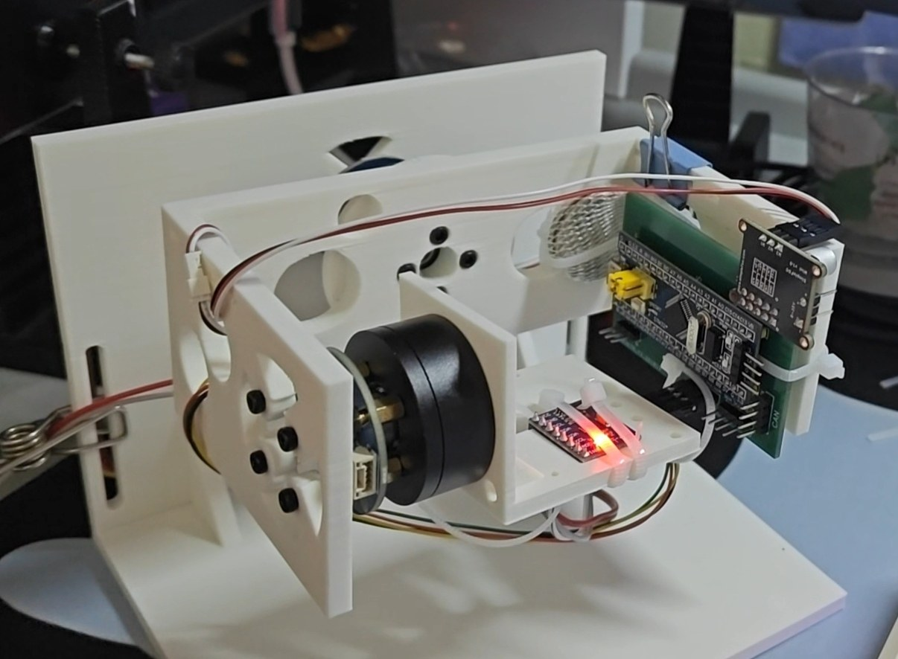
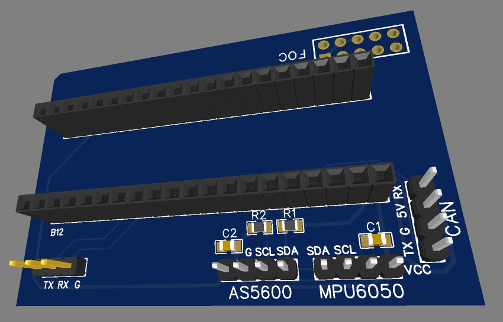
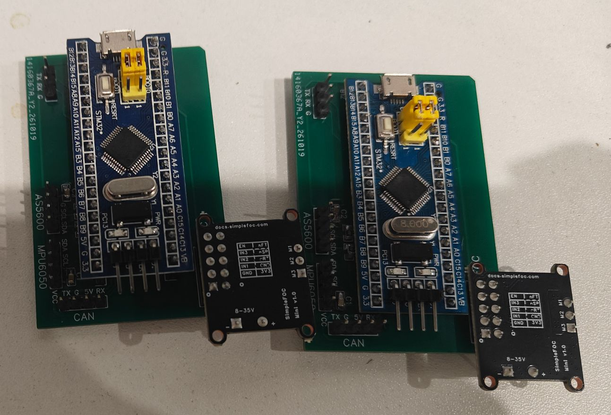
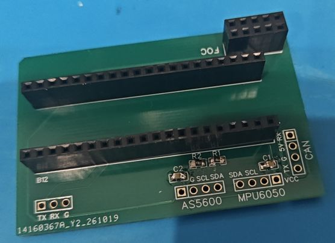
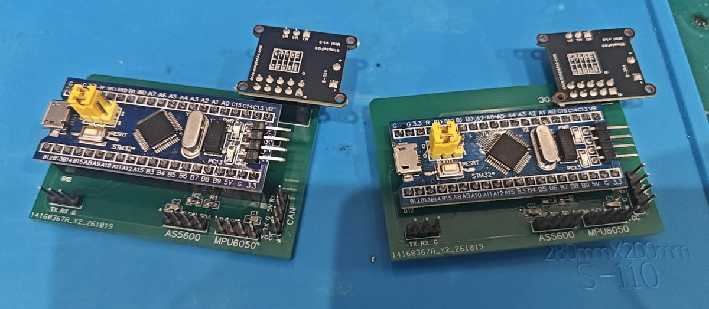
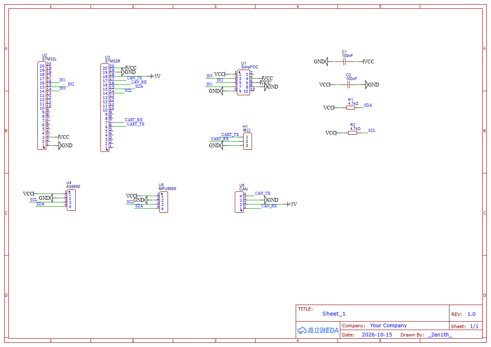

# STM32 双轴无刷云台

基于 STM32F103 + FreeRTOS 的电机控制：无刷 FOC 电压模式 + 2804无刷电机双轴云台（推进中）

## 技术栈

- MCU：STM32F103C8T6（Blue Pill）
- RTOS：FreeRTOS（CMSIS_V1）
- 工具链：STM32CubeMX + HAL + Keil MDK；FOC 验证用 Arduino（STM32 core）+ HAL；串口调试（USB-TTL/HC-05）
- 外设：TIM（PWM/编码器）、USART、I2C、GPIO
- 驱动：SimpleFOC Mini（DRV8313，无刷 FOC）、2804无刷电机*2
- 传感器：TIM3 编码器 / AS5600 磁编码器（I2C 0x36）/ MPU5060

## 自绘 FOC 开发套件板（第一版）

 

**63.87 × 42.29 mm · 2 层 · 板厚 1.6 mm · 立创 EDA 自绘 · 嘉立创打样 + 手焊（每轴一块，共两块）**

| 项目    | 设计                                                                           |
| ----- | ---------------------------------------------------------------------------- |
| 主控    | STM32F103C8T6 蓝板，2×20 排母直插（U2 / U3）                                          |
| 驱动    | SimpleFOC Mini（DRV8313）2×5 座（U1）；PWM = PA0 / PA1 / PA2，EN / nSP / nRT 接 3.3V |
| 编码器   | AS5600 1×4 座（U4），I2C 0x36；4.7 kΩ 上拉（R1/R2）+ 100 nF 去耦（C1/C2）                 |
| 姿态    | MPU6050 1×4 座（U5），与 AS5600 共用 I2C                                            |
| 预留    | CAN 1×4（U6）、串口 1×3（H1）                                                       |
| 信号完整性 | 底层整层地平面，顶层走线；电机三相大电流与 I2C 分边走线；传感器 3.3 V 取蓝板 USB；I2C经多次调整，为最短距离状态，保证抗干扰性；    |

**分级上电验证**：万用表通断 → 只插蓝板 → 逐个插模块 → 24 V → 电机。

两块板 3.3 V = 3.26 / 3.21 V、5 V = 5.10 / 5.11 V，无短路；AS5600(0x36) / MPU6050(0x68) 通信正常；20 kHz PWM 下 AS5600 连续读取零失败。

 

*左：0805 上拉/去耦与排母焊点特写　右：两块载板焊接 / 分级上电现场*

原理图如上

## 硬件

- STM32F103C8T6 + ST-Link + usb-ttl/ hc-05 + USB隔离器
- mpu6050 + 自制3D打印云台套件（第一版）
- 2804 无刷云台电机*2 + AS5600 + SimpleFOC Mini + 自绘开发套件PCB板（第一版） + 24V 适配器供电(PWM调节电压)

## 目录结构

- `STM32FreeRtos/` — Keil 工程（有刷 PID 闭环 + FreeRTOS 多任务）
- `Arduino/` — FOC / 传感器 / 姿态 / 位置环验证程序（Arduino STM32 core 烧录）
  - `foc/` 开环电压（sketch_oct10a / sketch_foc_openloop_voltage / sketch_foc_openloop_as5600）、Vq 对齐标定（sketch_foc_align_carrier / sketch_align / sketch_foc_align_check）、死区（sketch_deadzone）、手动调速（sketch_manual）
  - `as5600/`、`mpu6050/` 传感器单独验证
  -`sketch_mpu6050_who` I2C 扫描 + 上电检测
  -`sketch_mpu6050_raw` 六轴原始数据
  -`sketch_mpu6050_gyro` 陀螺零偏标定 + 轴/符号测试
  -`sketch_mpu6050_fusion` 加速度角 + 陀螺角速度联合测试，对齐符号
  -`sketch_mpu6050_angle` 纯加速度算 roll / pitch
  -`sketch_mpu6050_complementary` 互补滤波融合角,加速度角作对照
  - `attitude/` 姿态外环（roll / pitch）、符号核对 (sign)
  - `position/` 位置环（开发板版 / 载板版）
  - `bringup/` 上电保险测试
- `GimbalCAD/` — 云台结构 3D（v3 整机装配体 + 6 个零件 STEP）

## 当前进度

- FreeRTOS 多任务 / 队列通信
- PWM 调速（20kHz）+ L298N 方向控制
- 编码器测速（TIM3 编码器模式 ×4 倍频）
- PID 速度闭环（PI + 前馈 + 积分限幅 anti-windup）
- 位置环串级闭环（P + D + 死区）
- 多任务重构（控制/通信任务 + 队列 + osDelayUntil）
- 无刷 FOC（电压模式）：自写 Clarke / Park / 反 Park / SVPWM，不调用 SimpleFOC 库

#### 10.28 更新

- 自绘 2 层 PCB 板开发套件（63.87 × 42.29 mm）：打样、焊接、分级上电全部测试通过
- 20 kHz PWM 下 AS5600 连续读取零失败（PWM 干扰 I2C 复测通过）
- 载板开环电压 FOC 首转（24V、Vq=1V、约 8.6 rpm）
- 装配后换相线 → 交换两相恢复方向；3V 重对齐 **OFFSET=261.52**
- 滚转内环测试确认：**KP=0.03 / KD=0.05 / KI=0.0008 / INT_LIMIT=90**；此时静态 0.1~1.4°、20° 步进过冲 ~7°、无慢摆
- 当前俯仰环暂未开始测试。

## 记录

- 时钟：HSE + PLL ×9 = 72MHz（AHB/1、APB1/2=36M、APB2/1=72M）
- TT马达 50% 占空比电机堵转，改 80%（CCR=360）成功运转。
- TIM3 编码器模式（PA6=CH1/PA7=CH2，×4 倍频）实测电机轴每圈 52 计数、输出轴每圈 2496 计数，80% 占空比实测 202~208 rpm
- PID 速度闭环跑通、抗负载测试跑通
- osDelay产生节拍偏移导致位置环极限环振荡，改用osDelayUntil后现象变为震荡后收敛。
- 位置控制用减速箱有"回差"：收敛后电机停在固定两个角度而非精确 90°。
- 实时性优化：① 位置环由 bang-bang 改为 P + D 控制（kp_pos=40、kd_pos=0.3、限幅 ±200、死区 ±5°）② 控制任务优先级 Normal→AboveNormal

#### 10.28 更新

- 无刷 FOC 电压模式开环：UDC=24、Vq=1.0V、1Hz 电角 → 机械约 8.6 rpm；反 Park → 反 Clark → SVPWM（mid 零序注入）→ 三相 PWM
- 自绘开发板分级上电：FOC 模块 3V3 测试 1.9V，电阻全开路，为逻辑脚反灌；24V 三相全低刹车正常
- 重装后 3V 对齐：M1=274.38 → **OFFSET=261.52**（M−90/P）；相线接反，后纠正；
- I 扫描：固定积分上限无法兼顾 0.07~0.17V 的位置相关摩擦；经测试后定为**0.072V**（本人硬件低于此值在高摩擦角差 1.4°，高于则低摩擦角 stick-slip 慢摆）
- 位置环软件修正：误差绕回最短角；anti-windup = 输出未饱和 + |error|<10° 积分
- 电源：24V 适配器（无限流），靠 PWM 降到 ~12V 等效